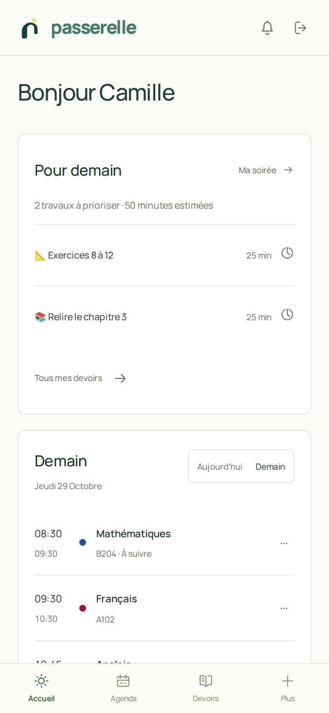
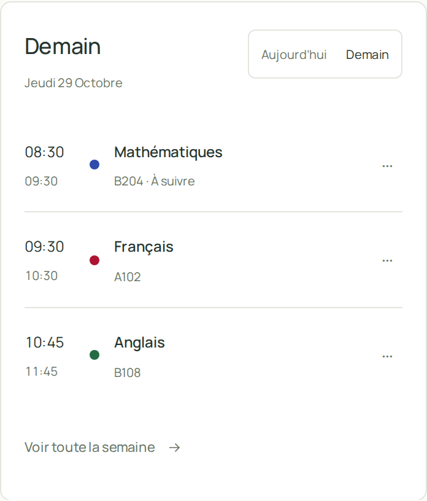
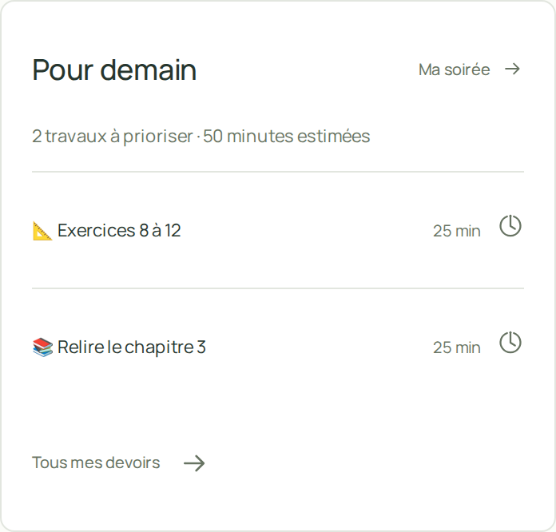

<div align="center">
  <a href="https://repere.84.235.226.127.sslip.io/agenda/">
    
  </a>
  <p><strong>Ta journée prend forme.</strong><br>Le lycée, un peu plus simple.</p>
  <p>
    <a href="https://repere.84.235.226.127.sslip.io/agenda/">Ouvrir Passerelle ↗</a>
    &nbsp;·&nbsp;
    <a href="https://github.com/camille2654/Passerelle-App/issues">Signaler un problème</a>
  </p>
  <p>
    
    
    
  </p>
</div>

<p align="center">
  
</p>

Passerelle rassemble au même endroit l’emploi du temps, les devoirs et les outils pour préparer sa semaine. L’application est pensée pour être installée comme une **PWA** sur téléphone, tout en restant accessible depuis un navigateur.

## Cours regroupés dans les calendriers abonnés · 4.26.5

Les séances strictement identiques et consécutives sont maintenant publiées comme un seul événement dans le lien ICS : mêmes matière, intitulé et salle, avec des horaires qui se touchent. Les données scolaires restent séparées dans Passerelle. Les liens d’agenda existants sont conservés et leurs abonnements sont reconstruits au démarrage du serveur.

## L’essentiel, sans se perdre

<table>
  <tr>
    <td width="33%" valign="top"><strong>Agenda</strong><br>Une vue du jour ou de la semaine, les cours et les changements, avec un lien ICS personnel pour s’abonner depuis son calendrier.</td>
    <td width="33%" valign="top"><strong>À préparer</strong><br>Devoirs, contrôles, priorités du soir, temps de concentration et notes liées aux matières.</td>
    <td width="33%" valign="top"><strong>Vie du lycée</strong><br>Actualités, messages, documents et nouveautés, selon les rubriques proposées par l’ENT connecté.</td>
  </tr>
  <tr>
    <td valign="top"><strong>Repères personnels</strong><br>Recherche, favoris, fiches de révision, rappels et bilan de la semaine.</td>
    <td valign="top"><strong>Sur téléphone</strong><br>Interface responsive, icône d’installation, notifications PWA et animations réduites si l’appareil le demande.</td>
    <td valign="top"><strong>Connexions</strong><br>Parcours ENT et connecteur Lapsus documentés ; les services externes nécessitent leur compatibilité et leur configuration.</td>
  </tr>
</table>

## Un aperçu sur mobile

Ces aperçus utilisent des données fictives.

<table>
  <tr>
    <td align="center" width="33%"><br><sub>Accueil · la journée à venir</sub></td>
    <td align="center" width="33%"><br><sub>Agenda · vue du jour</sub></td>
    <td align="center" width="33%"><br><sub>À préparer · les priorités</sub></td>
  </tr>
</table>

## Connexion et compatibilité

Connecte-toi avec les services réellement proposés par ton établissement. La disponibilité des cours, devoirs, notes, messages et actualités varie selon l’ENT et le lycée.

> **À savoir :** Passerelle ne prend pas encore en charge tous les ENT de toutes les régions. Le catalogue actuel couvre des établissements Skolengo de l’ENT Auvergne-Rhône-Alpes. La connexion PRONOTE via l’ENT dépend du portail et de son SSO ; elle n’est pas garantie partout. Les services de mails personnels et certains itinéraires demandent une configuration spécifique.

Le lien ICS est privé : toute personne qui le possède peut consulter le calendrier associé. Il peut être renouvelé ou désactivé depuis Passerelle. Dans Google Agenda, Apple Calendrier ou Outlook, ajoute-le comme **abonnement** pour recevoir les mises à jour ; un import unique ne se synchronise pas. La fréquence de rafraîchissement dépend aussi de l’application de calendrier.

## Démarrage local

### Prérequis

- Node.js et npm
- Git

### Lancer Passerelle

```bash
git clone https://github.com/camille2654/Passerelle-App.git
cd Passerelle-App
npm ci
npm start
```

Ouvre ensuite <http://127.0.0.1:8020/agenda/>. Les premières données de configuration sont créées dans `data/` au démarrage.

Pour un usage public, configure un nom de domaine, HTTPS, un proxy inverse et un service systemd. Le modèle de service est dans [`deploy/agenda-bridge.service`](deploy/agenda-bridge.service). Les paramètres du serveur incluent `AGENDA_PORT`, `AGENDA_BASE_URL` et `AGENDA_DATA_DIR`.

### Données privées

Le dossier `data/` contient les comptes, les connexions ENT, les calendriers et la clé de chiffrement. Il est exclu de Git : **ne le publie jamais**. Pour déplacer une installation, arrête le service et transfère ensemble `data/state.json` et `data/master.key` par un canal privé. Un seul processus Passerelle doit utiliser ce dossier à la fois.

## Documentation

| Sujet | Guide |
|---|---|
| Agenda, vues et événements | [Présentation de l’agenda](docs/AGENDA.md) |
| ENT et connexion PRONOTE | [Sources et compatibilité](docs/MULTI_ENT.md) |
| Devoirs, révisions et concentration | [Outils du quotidien](docs/DAILY_TOOLS.md) |
| Recherche et matières | [Recherche et fiches matières](docs/DISCOVERY.md) |
| Trajets et transports | [Fonctionnement et limites](docs/SMART_TRAVEL.md) |
| Connecter Lapsus | [Guide d’intégration](docs/LAPSUS_INTEGRATION.md) · [Connecteur ENT géré](docs/MANAGED_ENT.md) |
| État des services | [Page statut](public/status/index.html) · [Guide technique](docs/SYSTEM_STATUS.md) |
| Informations légales | [Mentions, confidentialité, CGU et cookies](public/legal/) · [Checklist éditeur](docs/LEGAL.md) |
| Identité et ressources graphiques | [Guide de style](docs/APP_STYLE.md) · [Studio social](public/brand/campaign/index.html) · [Bibliothèque d’icônes](public/brand/icons-v2/preview.html) |
| Annoncer une nouveauté | [Guide des versions majeures](docs/MAJOR_RELEASES.md) |

## Vérifications et contribution

Avant une contribution, les commandes disponibles sont :

```bash
npm run check
npm test
```

Les tests utilisent des données de démonstration. Ne joins jamais de compte, de token ENT, de lien ICS privé, de fichier `data/` ou de donnée scolaire réelle à une issue ou à une capture d’écran. Pour signaler un problème, indique la version, l’appareil et les étapes qui permettent de le reproduire.

Les contributions et suggestions sont les bienvenues via les [issues GitHub](https://github.com/camille2654/Passerelle-App/issues).

## Licence

Passerelle est distribué sous licence [GNU GPL v3 ou ultérieure](LICENSE). Les composants tiers conservent leurs licences respectives, indiquées à côté de leurs fichiers.
